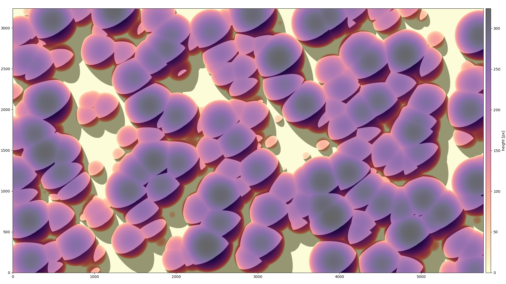

# gpu-dem-shadow-casting
Shadow ray casting for digital elevation models (raster data) using CUDA

The kernel uses dominant-axis ray stepping from pixel centers toward the sun.
The first terrain sample above the ray casts a shadow.

```python
shadow = cast_shadow(height_image, pixel_size=10.0, azimuth=135, elevation=25)
```

- `azimuth`: degrees clockwise from North (0 = North, 90 = East,
  180 = South, 270 = West); angles wrap at 360 degrees.
- `elevation`: degrees above the horizon (0 = horizon, 90 = zenith).
- `pixel_size`: square pixel spacing in the same units as terrain heights.
- `eps`: optional nonnegative height tolerance, in terrain height units
  (default `0`). A terrain sample must exceed the ray height by more than
  this amount to block sunlight.

Both sun angles accept either a scalar or a 2D raster with exactly the same
shape as `height_image`. Scalar inputs use the parallel-ray CUDA kernel;
if either angle is a raster, a second kernel reads each source pixel's angles.
The direction stays fixed along each ray. You can mix a scalar with a raster.

```python
# Both arrays have height_image.shape and contain angles in degrees.
shadow = cast_shadow(height_image, pixel_size=10.0,
                     azimuth=azimuth_raster, elevation=elevation_raster)

# Per-pixel azimuth with the same elevation everywhere.
shadow = cast_shadow(height_image, pixel_size=10.0,
                     azimuth=azimuth_raster, elevation=25)
```

Angle rasters must already be aligned with the elevation raster, including
row orientation. Supply finite angles in degrees after applying any source
data scaling or conversion; no resampling or metadata conversion is performed.
If your input angle is zenith rather than elevation, use `90 - zenith_raster`.
Elevation values must lie between 0 and 90; pixels at 90 are illuminated.

Rows increase northward and columns eastward; plot with `origin="lower"`.
The returned array has dtype `int16`, with 1 for shadow and 0 for illuminated
pixels. Rays stop at the raster boundary, so terrain outside it is ignored.

Install `numpy`, `numba`, `tqdm`, and `matplotlib` in a Python environment
with CUDA support. Run `python gpu-dem-shadow-casting.py` to generate the
example arrays, then `python shadow_image.py` to render them.

For CPU simulation, set `NUMBA_ENABLE_CUDASIM=1` before starting Python.
The full example is large; use small rasters when simulating.
Run the regression checks with `NUMBA_ENABLE_CUDASIM=1 python -m pytest -q`
(requires `pytest`).


